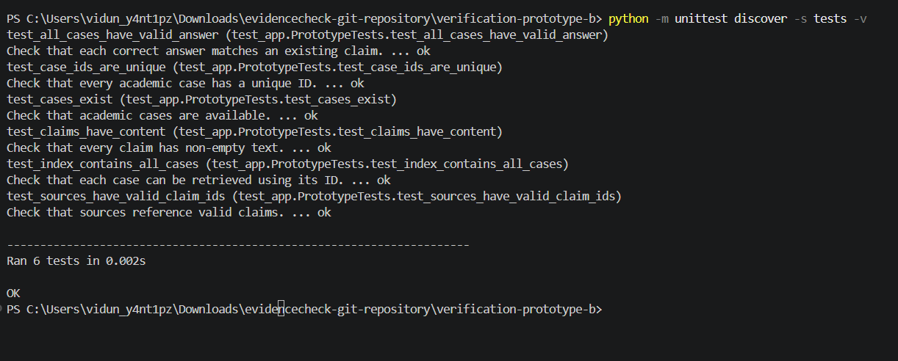

# EvidenceCheck

**AI Explanation Verification Prototype**

README prose word count: 1,440 words

## Project status

EvidenceCheck is an intelligent interactive web application designed to help students critically evaluate AI-generated explanations about unfamiliar academic topics.

The application provides two interface conditions using identical predefined explanations and answer keys.

### Standard interface

- Predefined academic explanations containing deliberate factual errors.
- Selection of the incorrect claim.
- Confidence rating from 0–100%.
- Deterministic correctness feedback.

### Enhanced interface

- Clickable claim-level citations and supporting source summaries.
- Four stages: Read & Inspect, Reflect, Decide and Review.
- Student reasoning input and optional AI verification coaching.
- Contextual verification questions generated using a Groq-hosted LLM.
- Proactive citation reminder when students proceed without inspecting evidence.
- Confidence rating and deterministic correctness feedback.
- Reversible navigation before submission.

The Enhanced interface is the main intelligent interactive contribution. The Standard interface provides a baseline for future evaluation.


## Technology and architecture

- **Python 3:** Standard-library HTTP server (`app.py`).
- **HTML, CSS and JavaScript:** Interface rendering, navigation and interaction tracking.
- **JSON (`cases.json`):** Predefined explanations, supporting evidence, answer keys and feedback.
- **Groq API:** Optional AI verification coaching using the `openai/gpt-oss-20b` model.

### Backend endpoints

| Endpoint | Purpose |
| --- | --- |
| `/api/cases` | Retrieves predefined academic cases. |
| `/api/grade` | Evaluates the student's selection against predefined ground truth. |
| `/api/prompt` | Generates a contextual AI verification question. |

Both interfaces share case data and deterministic grading. Only the Enhanced interface uses AI coaching.

The model receives the student's reasoning, explanation and supporting source summaries. Its instructions request a brief, non-leading verification question without revealing the answer.

The model does not determine correctness. The current design uses single-turn, student-initiated coaching rather than an autonomous agent loop.

## Running the application

Requires Python 3.10 or later. No additional Python packages are required.

### Start the server

From the project directory, run:

```bash
python app.py
```

Open [http://localhost:8000/](http://localhost:8000/) in a web browser.

Select either the Standard or Enhanced interface.

### Configure AI coaching

Provide your own Groq API key as an environment variable.

**Windows PowerShell:**

```powershell
$env:GROQ_API_KEY="your-own-key"
python app.py
```

**macOS/Linux:**

```bash
export GROQ_API_KEY="your-own-key"
python app.py
```

Never commit API keys to GitHub.

AI coaching is optional. If the external AI service is unavailable, students can continue independently using the remaining functionality.

## How to use EvidenceCheck

### Standard interface

1. Select an academic topic.
2. Read the explanation.
3. Identify the incorrect claim.
4. Rate confidence.
5. Submit and receive feedback.

### Enhanced interface

1. **Read & Inspect:** Read the explanation and optionally inspect numbered citations.
2. **Reflect:** Enter initial reasoning and optionally request an AI-generated verification question.
3. **Decide:** Identify the incorrect claim and rate confidence.
4. **Review:** Receive correctness feedback and revisit supporting evidence.

A proactive reminder appears if students attempt to enter Decide without opening citations. Students can review the evidence or continue anyway.

Backward navigation allows students to reconsider their reasoning before submitting without losing their progress.

Source summaries are author-written paraphrases rather than verbatim quotations.


## Testing

### Automated testing

The automated test suite was updated after removing simulated AI coaching, ensuring the tests reflect the current implementation.

Run the tests using:

```bash
python -m unittest discover -s tests -v
```

**Results: 6 tests passed, 0 failures (Python 3.13).**

The tests verify:

- Valid answer keys for predefined cases.
- Unique academic case identifiers.
- Availability of academic cases.
- Non-empty claim text.
- Correct case indexing.
- Valid source-to-claim relationships.

**Figure 1. Automated testing results showing six passing tests.**



### Manual testing

The following interactions were tested manually:

| Feature | Checks performed | Result |
|---|---|---|
| Citation inspection | Opened the same citation twice and checked that the unique citation count increased only once. | Passed |
| Proactive reminder | Attempted to enter Decide without inspecting citations. Tested both reviewing evidence and continuing without inspection. | Passed |
| Navigation | Returned to earlier stages and checked that written reasoning and selections were preserved. | Passed |
| Deterministic grading | Submitted correct and incorrect selections and compared feedback with predefined answer keys. | Passed |
| AI coaching | Requested contextual questions using different reasoning inputs and inspected their relevance and whether they revealed the answer. | Manually inspected |
| AI unavailability | Tested whether the activity could be completed without an AI-generated question. | Passed |

These checks demonstrate that the tested interactions functioned as intended. The automated tests verify case-data consistency, while the manual checks cover interface behaviour and AI interaction. They do not establish whether students' verification accuracy improves or guarantee the suitability of every generated question.


## Development record

The development of EvidenceCheck was informed by my Assignment 1 literature review, module concepts and lecturer feedback emphasising human-in-the-loop interaction, visibility, reversibility and the importance of excluding unnecessary functionality.

Subsequent lecturer feedback confirmed the suitability of the proposed contribution and recommended focusing on the design of the Enhanced interface, using module concepts to justify decisions through use cases.

### 1. Predefined cases and deterministic grading

**Change:** Created predefined academic explanations containing deliberate factual errors, supporting evidence, answer keys and explanatory feedback.

**Rationale:** Maintain consistent ground truth independently of LLM variability and separate correctness assessment from generative AI guidance.

**Checks:** Submitted correct and incorrect selections and compared the feedback against predefined answer keys. Automated tests also confirmed valid answer identifiers and consistent relationships between claims and sources. All six automated tests passed.


**Commit:** [Add deterministic case data, grading API, and bounded AI prompt endpoint](https://github.com/vathavan/LLM-Citation-Evaluator/commit/17e7a9b2f407af78f7905172d5fee0ccabba2e39)

### 2. Clickable citations and source inspection

**Change:** Developed claim-level clickable citations, source summaries, original source links, reasoning input and confidence ratings.

**Rationale:** Make supporting evidence accessible while encouraging students to evaluate individual claims independently. Source summaries are author-written paraphrases rather than verbatim quotations.

**Checks:** Opened citations to inspect their supporting information and tested repeated citation selection. Opening the same citation twice increased the unique inspection count only once.


**Commit:** [Build responsive student study flow, source inspector, coaching and grading UI](https://github.com/vathavan/LLM-Citation-Evaluator/commit/a77dfa76c9bd29eea75846e4615f635f9cd923e2)

### 3. Contextual AI coaching

**Change:** Replaced fixed verification prompts with contextual questions generated by a Groq-hosted language model. The model receives the student's reasoning, the explanation and curated source summaries.

**Rationale:** The original fixed prompts could not respond to individual reasoning. Context engineering allows guidance to be tailored to the student's input while maintaining human control. The model is instructed to generate one brief verification question without revealing the answer.

**Checks:** Requested verification questions using different reasoning inputs and manually inspected whether the generated questions were relevant and avoided revealing the answer. The model's output was treated as guidance rather than a guaranteed correct response.

**Relevant commits:**

- [Add deterministic case data, grading API, and bounded AI prompt endpoint](https://github.com/vathavan/LLM-Citation-Evaluator/commit/17e7a9b2f407af78f7905172d5fee0ccabba2e39)
- [Update EvidenceCheck with staged interface and AI verification features](https://github.com/vathavan/LLM-Citation-Evaluator/commit/ff591582e576c224317a87d6f8eb44f54ca9c779)

### 4. Proactive citation reminder

**Change:** Introduced a rule-based reminder when students attempt to enter the Decide stage without opening any citations.

**Rationale:** The original reactive interface made evidence available but did not actively encourage its inspection. The reminder applies mixed initiative and context-sensitive timing while allowing students to dismiss the intervention and continue independently.

**Checks:** Attempted to enter Decide without opening citations and confirmed that the reminder appeared. Tested both options: returning to inspect evidence and continuing without inspection.


**Commit:** [Update EvidenceCheck with staged interface and AI verification features](https://github.com/vathavan/LLM-Citation-Evaluator/commit/ff591582e576c224317a87d6f8eb44f54ca9c779)

### 5. Four-stage interface and reversible navigation

**Change:** Reorganised the original scrolling interface into four stages: Read & Inspect, Reflect, Decide and Review. Added visible progress indicators and backward navigation.

**Rationale:** Presenting one task at a time reduces competing information and is intended to reduce unnecessary cognitive load. Lecturer feedback emphasising visibility and reversibility informed the provision of progress indicators and opportunities to reconsider reasoning before submission.

**Checks:** Navigated backwards between stages and confirmed that entered reasoning and selections were preserved, allowing students to reconsider their judgement without restarting.

**Relevant commits:**

- [Update EvidenceCheck with staged interface and AI verification features](https://github.com/vathavan/LLM-Citation-Evaluator/commit/ff591582e576c224317a87d6f8eb44f54ca9c779)
- [Update README with staged interface and development record](https://github.com/vathavan/LLM-Citation-Evaluator/commit/406f255b3b9b64d5ce649393bab4c155a1509b51)

### 6. Addition of the Standard interface

**Change:** Introduced an interface-selection page and a Standard interface that shares the same academic cases, confidence ratings and deterministic grading as the Enhanced interface.

**Rationale:** Provide a baseline for comparison without duplicating the assessment backend. Following lecturer feedback, the Enhanced interface remains the main intelligent interactive contribution.

**Checks:** Submitted correct and incorrect claim selections and checked the resulting feedback against the predefined answer keys. Both interfaces use the same grading mechanism.

**Commit:** [Add Standard comparison interface and remove simulated AI coaching](https://github.com/vathavan/LLM-Citation-Evaluator/commit/27c1070)


### 7. Removal of rule-based coaching simulation

**Change:** Removed the simulated coaching mode and its associated interface selector. Retained optional live LLM-generated coaching and the separate rule-based citation reminder.

**Rationale:** Simulated coaching was initially included to demonstrate the guidance interaction without API access. However, it introduced an additional interface choice without directly contributing to the research problem. Removing it also reflects lecturer feedback on excluding unnecessary functionality.

**Checks:** Tested live AI coaching with different reasoning inputs and confirmed that students could complete the activity without AI assistance. The automated tests were also updated to remove references to the deleted simulation function.

**Commit:** [Add Standard comparison interface and remove simulated AI coaching](https://github.com/vathavan/LLM-Citation-Evaluator/commit/27c1070)

### 8. Documentation, testing and refinement

**Change:** Added setup instructions, documented the boundaries of AI coaching and updated the automated test suite after removing simulated coaching.

**Rationale:** Maintain reproducible testing and ensure that tests reflect the functionality of the current prototype.

**Testing and refinement:** After simulated AI coaching was removed, the automated tests initially failed because `test_app.py` still imported the deleted `simulate_prompt` function. I removed the obsolete tests and introduced six checks covering case availability, unique identifiers, valid answer keys, claim content, case indexing and source-to-claim relationships.

**Result:** All six updated automated tests passed using Python 3.13. A screenshot of the successful execution is included in the Testing section.

**Original testing commit:** [Document reproducible setup, AI boundaries and development evidence; add unit tests](https://github.com/vathavan/LLM-Citation-Evaluator/commit/3ff587008d61d3d4df71bdeb99f688df55bfdb2d)

**Updated tests:** [Document six passing unit tests with screenshot](https://github.com/vathavan/LLM-Citation-Evaluator/commit/747fc4f)

## AI assistance

ChatGPT was used to support application development, debugging, interface design, prompt construction, documentation and report drafting.

| Task | AI assistance | Application and adaptation | Verification |
| --- | --- | --- | --- |
| Backend development | Assistance with Python endpoints, case data and grading logic. | Retained deterministic grading to separate correctness assessment from AI coaching. | Checked grading against predefined answer keys and run automated tests. |
| AI verification coaching | Assistance with Groq API integration. | Restricted the intended coaching role to brief contextual questions rather than providing answers. | Inspected generated questions for relevance and unintended answer disclosure. |
| Interface development | Suggestions for HTML, CSS, JavaScript, staged navigation and interaction tracking. | Adapted the interface to provide four stages, reversible navigation and optional guidance. | Checked navigation, state preservation and citation tracking. |
| Documentation and storyboards | Assistance with README organisation and storyboard illustrations. | Created my own storyboards and scenarios but used AI to improve their visual presentation. | Compared illustrations against the final application and checked that README revisions preserved the intended content. |

AI-generated suggestions were treated as development assistance rather than automatically accepted solutions. Final design decisions remained my responsibility.

**Example of reviewing and adapting AI assistance:** ChatGPT supported the implementation of AI verification coaching and automated tests. However, the final design deliberately separates AI-generated guidance from correctness assessment: the LLM generates contextual verification questions, while predefined answer keys determine grading. Following the removal of simulated coaching, I also revised the automated tests because they still referenced a deleted function. The updated tests were executed successfully, demonstrating that AI-assisted code and documentation were checked and adapted rather than accepted without verification.

## Limitations and future work

EvidenceCheck currently uses two predefined academic cases, providing consistent ground truth but limiting the range of learning topics. Citation inspection is recorded, although opening a citation does not demonstrate that the student understood its evidence.

LLM-generated verification questions may vary in quality despite prompt constraints. Future development could introduce additional output validation to identify unsuitable questions before displaying them.

User-selected academic topics and dynamic evidence retrieval could extend the prototype, requiring safeguards for source reliability, provenance, factual accuracy and consistent grading. Multi-turn coaching could also support iterative reflection while preserving student control.

The Standard interface provides a comparison baseline. As the Enhanced interface incorporates several verification features, any comparison would assess their combined effect rather than isolate individual contributions.
